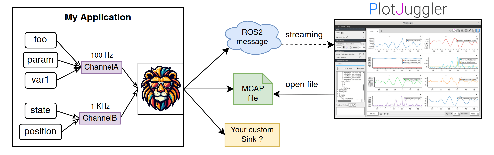

[](https://github.com/facontidavide/data_tamer/actions/workflows/cmake_ubuntu.yml)
[](https://github.com/facontidavide/data_tamer/actions/workflows/ros2-humble.yml)
[](https://github.com/facontidavide/data_tamer/actions/workflows/ros2-jazzy.yml)
[](https://github.com/facontidavide/data_tamer/actions/workflows/ros2-lyrical.yml)
[](https://github.com/facontidavide/data_tamer/actions/workflows/ros2-rolling.yml)
[](https://codecov.io/gh/facontidavide/data_tamer)

**DataTamer** is a library to log/trace numerical variables over time and
takes periodic "snapshots" of their values, to later visualize them as **timeseries**.

It works great with [PlotJuggler](https://github.com/facontidavide/PlotJuggler),
the timeseries visualization tool (note: you will need PlotJuggler **4** or later).
For ROS 2 topics and rosbag2 recordings, use [Foxglove with the data_tamer
extension](data_tamer_foxglove/extension/README.md) (desktop or web).

**DataTamer** is "fearless data logger" because you can record hundreds or **thousands of variables**:
even 1 million points per second should have a fairly small CPU overhead.

Since all the values are aggregated in a single "snapshot", it is usually meant to
record data in a periodic loop (a very frequent use case, in robotics applications).

Kudos to [pal_statistics](https://github.com/pal-robotics/pal_statistics), for inspiring this project.

## How it works



DataTamer can be used to monitor multiple variables in your applications.

**Channels** are used to take "snapshots" of a subset of variables at a given time.
If you want to record at different frequencies, you can use different channels.

DataTamer will forward the collected data to 1 or multiple **sinks**;
a sink may save the information immediately in a file (currently, we support [MCAP](https://mcap.dev/))
or publish it using an inter-process communication, for instance, a ROS2 publisher.

You can easily create your own, specialized sinks.

Use [PlotJuggler](https://github.com/facontidavide/PlotJuggler) to
visualize your logs offline or in real-time.

## Features

- **Serialization schema is created at run-time**: no need to do code generation.
- **Suitable for real-time applications**: very low latency (on the side of the callee);
  once logging started (`startLogging()` before the loop), `tryTakeSnapshot()` neither
  blocks nor allocates. With Clang 20 or later, the real-time API is
  `[[clang::nonblocking]]`, so `-Wfunction-effects` and RealtimeSanitizer check your
  control loop.
- **Multi-sink architecture**: recorded data can be forwarded to multiple "backends".
- **Very low serialization overhead**, in the order of 1 bit per traced value.
- The user can enable/disable traced variables at run-time.
- **Flight recorder**: `MCAPRingSink` keeps the last seconds in RAM and writes an MCAP file
  only when you ask, for instance after a fault.

# Examples

## Basic example

```cpp
#include "data_tamer_v2/channel.hpp"
#include "data_tamer_v2/sinks/mcap_sink.hpp"

#include <chrono>
#include <cmath>
#include <thread>

int main()
{
  // The channel borrows these variables: declare them first so they outlive it.
  double shoulder_position = 0, shoulder_velocity = 0, shoulder_effort = 0;
  double elbow_position = 0, elbow_velocity = 0, elbow_effort = 0;

  // A worker that owns the sink writing the file (mcap->sink() is the MCAPSink). The
  // channel takes snapshots and hands them to its sinks.
  auto mcap = DataTamer2::MCAPSink::create("T01_joint_states.mcap");
  auto channel = DataTamer2::LogChannel::create("controller");
  channel->addDataSink(mcap);

  channel->registerValue("shoulder/position", &shoulder_position);
  channel->registerValue("shoulder/velocity", &shoulder_velocity);
  channel->registerValue("shoulder/effort", &shoulder_effort);
  channel->registerValue("elbow/position", &elbow_position);
  channel->registerValue("elbow/velocity", &elbow_velocity);
  channel->registerValue("elbow/effort", &elbow_effort);

  for(int cycle = 0; cycle < 1500; ++cycle)
  {
    const double t = cycle * 0.001;
    shoulder_position = std::sin(4 * t);
    shoulder_velocity = 4 * std::cos(4 * t);
    shoulder_effort = 0.2 * std::sin(4 * t);
    elbow_position = std::sin(4 * t + 0.5);
    elbow_velocity = 4 * std::cos(4 * t + 0.5);
    elbow_effort = 0.2 * std::sin(4 * t + 0.5);
    channel->takeSnapshot();  // One sample of every registered value.
    std::this_thread::sleep_for(std::chrono::milliseconds(1));
  }
  mcap->stop();  // Deliver queued snapshots and close the file, including its footer.
}
```

## How to register custom types

`std::string` and `std::string_view` values are recorded as text (the schema type
`string`), and containers such as `std::vector` and `std::array` work out of the box,
including containers of texts and of your own types. Describe a struct in its own namespace:

```cpp
#include "data_tamer_v2/channel.hpp"

#include <string_view>
#include <vector>

namespace robot
{
struct JointState
{
  double position = 0;
  double velocity = 0;
  double effort = 0;
};

// Put this beside your own type so argument-dependent lookup finds it.
template <typename AddField>
std::string_view TypeDefinition(JointState& joint, AddField& add)
{
  add("position", &joint.position);
  add("velocity", &joint.velocity);
  add("effort", &joint.effort);
  return "JointState";
}
}  // namespace robot
```

Declare `std::vector<robot::JointState> joints(2);` before the channel, then call
`channel->registerValue("joints", &joints);`. The recorded series include
`joints[0]/position`, `joints[0]/velocity` and `joints[0]/effort`.

For a type whose namespace you cannot modify, specialize
`DataTamer2::TypeDefinitionTrait<T>` with a static `define(T&, AddField&)` instead.
[T02_custom_types.cpp](data_tamer_cpp/examples/T02_custom_types.cpp) shows both forms
in one file, including a vendor class with accessors. Return a string literal for the
type name: the definition also runs when taking snapshots.

More examples: follow the [progressive tutorial](data_tamer_cpp/examples/README.md),
from a joint-controller MCAP recording to threads, a flight recorder and a custom sink.
The same directory also contains the throughput and ROS 2 demos.

# Documentation

- [User manual](docs/USER_MANUAL.md): registration, threads, real-time use, sinks,
  troubleshooting and FAQ.
- [Reference for coding agents](docs/llm_user_manual.md): every rule and corner case.
- [Wire format](docs/wire_format.md): the serialization format.
- [Migrating from 1.x](docs/MIGRATION.md): what to change when you upgrade to 2.0.
- [CHANGELOG](data_tamer_cpp/CHANGELOG.rst): what changed in each version.

# Compilation

The library builds with CMake 3.22 and a C++20 compiler; programs that use it need
C++17. Under any build, a consumer links it the same way:

```cmake
find_package(data_tamer 2 REQUIRED)
target_link_libraries(my_app PRIVATE data_tamer::data_tamer)
```

## Compiling with ROS 2

The ROS 2 package of 2.x is `data_tamer_v2` (in the `data_tamer_cpp/` folder): it
installs side by side with `data_tamer_cpp`, the 1.x package: its headers are in
`include/data_tamer_v2` and its library is `libdata_tamer_v2.so`. Depend on it with
`<depend>data_tamer_v2</depend>`; `find_package(data_tamer_v2 REQUIRED)` with the target
`data_tamer_v2::data_tamer` works as well as `data_tamer::data_tamer`.

Put the repository in the `src/` folder of a colcon workspace and run `colcon build`. The
tests are built when `BUILD_TESTING` is ON (colcon's default); pass
`--cmake-args -DBUILD_TESTING=OFF` to skip them.

## Compiling with CMake

Needs zstd and lz4 (on Ubuntu, `libzstd-dev liblz4-dev`), and GTest (`libgtest-dev`) for
the tests, which a top-level build includes unless `-DDATA_TAMER_BUILD_TESTS=OFF`. CMake downloads the MCAP C++
headers (release 2.1.3, pinned by hash) with FetchContent. Without network access, pass
`-DFETCHCONTENT_SOURCE_DIR_DATA_TAMER_MCAP=<dir>`, an unpacked copy of
[the release archive](https://github.com/foxglove/mcap/archive/refs/tags/releases/cpp/v2.1.3.tar.gz),
or use an installed MCAP with `DATA_TAMER_USE_SYSTEM_MCAP`.
From the repository root:

```
cmake -S data_tamer_cpp -B build -DCMAKE_BUILD_TYPE=Release
cmake --build build --parallel
cmake --install build --prefix /usr/local
```

| Option | Default | |
|---|---|---|
| `BUILD_SHARED_LIBS` | `OFF` | Shared library (always ON under ROS 2). |
| `DATA_TAMER_BUILD_TESTS`, `_EXAMPLES`, `_BENCHMARKS` | top level | Under ROS 2, tests also need `BUILD_TESTING`. |
| `DATA_TAMER_BUILD_ROS` | top level | The ROS 2 package, when `ament_cmake` is found. |
| `DATA_TAMER_INSTALL` | top level | Install rules. |
| `DATA_TAMER_WERROR` | `OFF` | Warnings in the library are errors (the presets and CI turn it ON). |
| `DATA_TAMER_USE_SYSTEM_MCAP` | `OFF` | `find_package(mcap)` instead of downloading MCAP. |

"Top level" means ON when data_tamer is the project being built and OFF when it is
added with `add_subdirectory()` or FetchContent: then it is a plain library target,
`data_tamer::data_tamer`, without ROS 2, and installs nothing.

## Compiling with Conan

The ROS 2 publisher is not built this way. Conan 2.4 or later. From `data_tamer_cpp/`,
`conan create . --build=missing` packages the library (MCAP from the `mcap` package) and
builds [test_package](data_tamer_cpp/test_package) against it. To develop with
dependencies from conan:

```
conan install . -s compiler.cppstd=gnu17 --build=missing -s build_type=Release
cmake -S . -B build/Release -DCMAKE_BUILD_TYPE=Release -DDATA_TAMER_USE_SYSTEM_MCAP=ON \
      -DCMAKE_TOOLCHAIN_FILE="build/Release/generators/conan_toolchain.cmake"
cmake --build build/Release --parallel
```

## Third-party code

- [MCAP](https://github.com/foxglove/mcap) C++ 2.1.3, by Foxglove, MIT licence: not in the
  repository. Downloaded at configure time outside ROS 2, and its headers and `LICENSE`
  are installed in `include/data_tamer_v2_mcap/mcap`.
- `data_tamer_cpp/cmake/Findzstd.cmake` and `Findlz4.cmake`: adapted from find modules by
  Meta Platforms, Apache License 2.0 (notice in each file).

# How to deserialize data recorded with DataTamer

The format is specified in [docs/wire_format.md](docs/wire_format.md), and there are three
decoders:

- C++: [data_tamer_parser.hpp](data_tamer_cpp/include/data_tamer_v2/data_tamer_parser.hpp),
  a single header without external dependencies that you can copy into your project.
  With the library linked, `data_tamer_v2/mcap_reader.hpp` reads a whole file in a few
  lines (`ForEachValue()`, `ForEachSnapshot()`), as
  [T08_mcap_reader](data_tamer_cpp/examples/T08_mcap_reader.cpp) does.
- Python: [python/data_tamer_parser.py](python/data_tamer_parser.py), standard library only,
  packaged as `data-tamer-parser` (see [python/README.md](python/README.md)), with
  `parse_snapshot_values()` to build columns for pandas or numpy.
- TypeScript: [`@data-tamer/parser`](data_tamer_foxglove/README.md), no runtime
  dependencies, which the [Foxglove extension](data_tamer_foxglove/extension/README.md)
  bundles.

All three read the files of data_tamer 1.x and 2.x, but not those of releases before 0.7.0.
