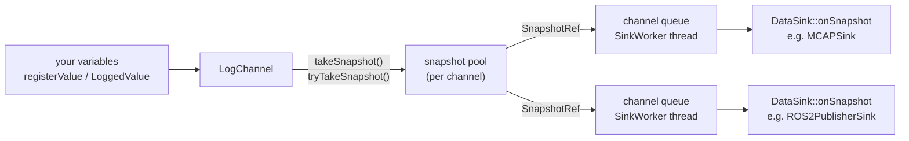

# data_tamer user manual for coding agents

data_tamer records the values of many C++ variables at once, as one "snapshot" per call,
usually from a periodic control loop, and delivers the snapshots to sinks: MCAP files, a
RAM flight recorder, ROS 2 topics or your own sink. This manual is for an agent adding
data_tamer logging to another code base. Header paths are relative to
`data_tamer_cpp/include/`. To change the library itself, read `CLAUDE.md` instead. To
port code written for 1.x, start with `docs/MIGRATION.md`.

## Linking

Consumers need C++17. Every install (CMake, conan, ROS 2) provides:

```cmake
find_package(data_tamer 2 REQUIRED)
target_link_libraries(my_app PRIVATE data_tamer::data_tamer)
```

Under ROS 2, add `<depend>data_tamer_v2</depend>` to `package.xml`. The ament package
is `data_tamer_v2`, so `find_package(data_tamer_v2 REQUIRED)` with
`data_tamer_v2::data_tamer` works as well; `data_tamer::data_tamer` forwards to it.
`data_tamer_cpp` is the 1.x package: it installs side by side (2.x headers are in
`include/data_tamer_v2`, the library is `libdata_tamer_v2.so`), but never link both into
one program. `ros2 run data_tamer_v2 ros2_publisher` runs the example publisher.

As a subproject (`add_subdirectory()`, FetchContent), link `data_tamer::data_tamer`. The
subproject builds no ROS 2 sink, no tests or examples and has no install rules, unless
`DATA_TAMER_BUILD_ROS`, `DATA_TAMER_BUILD_TESTS`, `DATA_TAMER_BUILD_EXAMPLES` or
`DATA_TAMER_INSTALL` is set ON.

`ROS2PublisherSink` exists only in the ROS 2 build (the build defines `USING_ROS2`).

`data_tamer_v2/sinks/mcap_encoding.hpp` includes `<mcap/writer.hpp>`. The target carries
those headers: MCAP 2.1.3, which the build downloads (installed in
`include/data_tamer_v2_mcap`),
`mcap_vendor::mcap` under ROS 2, or conan's `mcap`. Outside ROS 2, libdata_tamer contains
the MCAP implementation: never define `MCAP_IMPLEMENTATION` and never link another MCAP
build into the same program. Under ROS 2 the implementation is `mcap_vendor`'s
`libmcap`, linked through the target. A static install also links zstd and lz4: its CMake
package finds them on the machine that builds the consumer.

### Versions and binary compatibility

- `DATA_TAMER_VERSION` (defined by the target) is the library version, `X.Y.Z`. The shared
  library installs as `libdata_tamer.so.X.Y.Z` with the SONAME `libdata_tamer.so.X`
  (`libdata_tamer.so.2` for every 2.x release; under ROS 2 `libdata_tamer_v2.so.2`). A
  binary linked against it loads any later `2.x` library, so a minor or patch update can
  replace the `.so` without rebuilding. A new major version has a new SONAME: rebuild.
- `find_package(data_tamer 2 REQUIRED)` accepts any `2.x` and rejects other majors.
- Code you compile into your binary does not change when the library is updated in place:
  the header-only parts (`LoggedValue::set`, the `registerValue` templates, default
  arguments, member initializers of option structs such as `ROS2PublisherOptions`) keep
  the behaviour of the headers you built with. Rebuild to pick up a changed default.
- A custom `DataSink` or `CustomSerializer` keeps working across `2.x`: their virtual
  interfaces are frozen for 2.x.

The runnable [tutorial series](../data_tamer_cpp/examples/README.md) uses one robot-arm
controller throughout: start with T01, then add types, rates, real-time use and threads.

## Mental model



- `ChannelsRegistry` (`data_tamer_v2/data_tamer.hpp`) creates channels by name, applies
  default settings and attaches default sinks to them, and stops every sink at shutdown
  (`shutdown()`). `ChannelsRegistry::Global()` is a process-wide instance. You can also
  create channels directly with `LogChannel::create(name)`.
- `LogChannel` (`data_tamer_v2/channel.hpp`) holds pointers to registered variables. It
  reads them only when you take a snapshot. One channel is one schema and one rate: use
  several channels for several loops or rates.
- `startLogging()` freezes the schema, allocates a pool of snapshot slots plus one queue per
  attached sink, as long as the pool, and announces the schema to every attached sink
  (`DataSink::onSchema()`).
- `takeSnapshot()` or `tryTakeSnapshot()` serializes every enabled value into a free pool
  slot and pushes a reference (`SnapshotRef`) into the channel's queue on each attached
  sink. The slot returns to the pool when the last sink releases its reference. A queued
  reference holds a slot, so a queue can't fill while the pool has a free slot: the pool
  is the only bound.
- `SinkWorker` (`data_tamer_v2/data_sink.hpp`) owns one `DataSink`, the queues of the
  channels attached to it and the thread that calls `onSnapshot()`. Channels take sinks
  as `std::shared_ptr<SinkWorker>`. `SinkWorkerOf<T>`, what the `create()` helpers return,
  is a `SinkWorker` whose `sink()` is the `T`.

## Headers

| You need | Include |
|---|---|
| `LogChannel`, `LoggedValue`, `JoinNames`, `SnapshotResult`, `accepted()` | `data_tamer_v2/channel.hpp` |
| The accessors of a `LoggedValue` you already hold | `data_tamer_v2/logged_value.hpp` (creating one needs `channel.hpp`) |
| `ChannelsRegistry`, and everything `channel.hpp` provides | `data_tamer_v2/data_tamer.hpp` |
| `DataSink`, `SinkWorker`, `SinkWorkerOf`, `Snapshot`, `SnapshotRef` | `data_tamer_v2/data_sink.hpp` |
| `Schema`, `ToStr(schema)`, `SchemaFormat` | `data_tamer_v2/types.hpp` |
| `TypeDefinitionTrait` | `data_tamer_v2/custom_types.hpp` (also pulled in by `channel.hpp`) |
| `MCAPSink` | `data_tamer_v2/sinks/mcap_sink.hpp` |
| `MCAPRingSink`, `MCAPRingOptions` | `data_tamer_v2/sinks/mcap_ring_sink.hpp` |
| `ROS2PublisherSink`, `ROS2PublisherOptions` | `data_tamer_v2/sinks/ros2_publisher_sink.hpp` |
| `DummySink` (tests) | `data_tamer_v2/sinks/dummy_sink.hpp` |
| `ToSnapshotView(const Snapshot&)`, for the parser | `data_tamer_v2/decode.hpp` |
| `ForEachSnapshot()`, `ForEachValue()` (read an MCAP file) | `data_tamer_v2/mcap_reader.hpp` |
| `mcap_encoding::AddChannel()`, `WriteSnapshot()` (write data_tamer MCAP files yourself) | `data_tamer_v2/sinks/mcap_encoding.hpp` |
| `DataTamerParser::BuildSchemaFromText()`, `ParseSnapshot()` (no library needed) | `data_tamer_v2/data_tamer_parser.hpp` |
| forward declarations only | `data_tamer_v2/fwd.hpp` |

`data_tamer_v2/data_tamer.hpp` includes `channel.hpp`, which includes `data_sink.hpp`. A
header that only names the types (a `std::shared_ptr<LogChannel>` member, a `LogChannel&`
parameter) can include `fwd.hpp` instead.

Everything is in the namespace `DataTamer2` (1.x used `DataTamer`). `SerializeMe` and
`DataTamerParser` keep their 1.x names, inside an inline namespace `v2` that code never
names.

## Minimal end-to-end example

A 1 kHz loop that logs four joints, a cycle time and a mode to an MCAP file. It compiles
as C++17 against the current headers and decodes with the Python reader.

```cpp
#include "data_tamer_v2/channel.hpp"
#include "data_tamer_v2/sinks/mcap_sink.hpp"

#include <array>
#include <chrono>
#include <cmath>
#include <cstdio>
#include <string_view>
#include <thread>

namespace robot
{
struct JointState
{
  double position = 0;
  double velocity = 0;
  float effort = 0;
};
}  // namespace robot

// Describes JointState without touching namespace robot.
template <>
struct DataTamer2::TypeDefinitionTrait<robot::JointState>
{
  template <typename AddField>
  static std::string_view define(robot::JointState& js, AddField& add)
  {
    add("position", &js.position);
    add("velocity", &js.velocity);
    add("effort", &js.effort);
    return "JointState";
  }
};

int main()
{
  using namespace std::chrono_literals;

  // Registered variables are declared before the channel, so they outlive it.
  std::array<robot::JointState, 4> joints{};
  double cycle_time_ms = 0;

  auto mcap = DataTamer2::MCAPSink::create("control.mcap");
  // Every 10 minutes the recording continues in control_1.mcap, control_2.mcap, ...
  // (the default). setCreateNewFileOnReset(false) would truncate control.mcap instead.

  auto channel = DataTamer2::LogChannel::create("control");
  channel->addDataSink(mcap);

  const std::array<const char*, 4> legs = { "LF", "RF", "LH", "RH" };
  for(size_t i = 0; i < joints.size(); ++i)
  {
    channel->registerValue(DataTamer2::JoinNames("joints", legs[i]), &joints[i]);
  }
  channel->registerValue("cycle_time_ms", &cycle_time_ms);
  auto mode = channel->createLoggedValue<int32_t>("mode");  // RAII, atomic

  channel->setPoolCapacity(200ms, 1ms);  // absorb a 200 ms sink stall at 1 kHz
  channel->startLogging();             // freeze schema, allocate pool, announce

  uint64_t lost = 0;
  for(int i = 0; i < 2000; ++i)  // 1 kHz control loop
  {
    const auto start = std::chrono::steady_clock::now();
    for(auto& joint : joints)
    {
      joint.position = std::sin(i * 0.001);
      joint.velocity = std::cos(i * 0.001);
    }
    mode->set(i < 1000 ? 0 : 1);

    if(!DataTamer2::accepted(channel->tryTakeSnapshot()))  // ok or partial
    {
      ++lost;  // count, never block or log here; stats() says why
    }
    cycle_time_ms = std::chrono::duration<double, std::milli>(
                        std::chrono::steady_clock::now() - start)
                        .count();
    std::this_thread::sleep_for(1ms);
  }

  mcap->stop();  // deliver what is still queued, then close the file
  const auto stats = channel->stats();
  std::printf("lost %llu, pool_exhausted %llu, oversize %llu, sink errors %llu\n",
              static_cast<unsigned long long>(lost),
              static_cast<unsigned long long>(stats.pool_exhausted),
              static_cast<unsigned long long>(stats.dropped_oversize),
              static_cast<unsigned long long>(mcap->errors()));
  return 0;
}
```

The recorded names are `joints/LF/position`, `joints/LF/velocity`, ...,
`cycle_time_ms` and `mode`.

## Registering values

Choose by who writes the value:

| Written by | Register it with |
|---|---|
| Only the thread that calls `takeSnapshot()` | `registerValue(name, &var)`: borrowed, so `var` must outlive the registration or be unregistered first. |
| Another thread | `createLoggedValue<T>(name)`: the channel owns it, a scalar is atomic, a non-scalar goes through `getMutablePtr()`. Raw `registerValue()` variables are written inside `scopedWrite()`, which also keeps several values consistent. |

`LogChannel` (`data_tamer_v2/channel.hpp`) offers:

- `registerValue(name, const T* ptr)` for integers, `float`, `double`, `bool`, `char`,
  enums (recorded as their underlying type), `std::atomic<T>` of those (read with a relaxed
  load), `std::vector<T>`, `std::array<T, N>` (N from 1 to 65535) and custom types (see
  [Custom types](#custom-types)). Returns a `RegistrationID`.
- `createLoggedValue<T>(name, initial_value = T{})` returns a
  `std::shared_ptr<LoggedValue<T>>` that owns the variable and unregisters it in its
  destructor (`data_tamer_v2/logged_value.hpp`). `T` defaults to `double`.
- `registerCustomValue(name, ptr, CustomSerializer::Ptr)` bypasses the built-in
  serialization. Generic decoders may not be able to read the result: prefer a custom
  type. Its `serializedSize()`, `isFixedSize()` and `serialize()` run in every snapshot,
  `tryTakeSnapshot()` included: no allocation, lock or throw.

An integer is recorded by size and signedness, so `long long`, `unsigned long long`,
`char16_t` and `char32_t` work like `int64_t`, `uint64_t`, `uint16_t` and `uint32_t`, and
`wchar_t` like the integer of its size and signedness. `long double` has no wire type: it
is a compile error ("numeric type has no wire type"), use `double`.

Text is the schema type `string` (a `uint32` byte count and the bytes, whatever the
length): a `std::string`, any other `std::basic_string<char>` (`std::pmr::string`) or a
`std::string_view`, registered on its own, as a member of a custom type, or as the
element of a `std::vector` (`string[]`) or `std::array` (`string[N]`), and
`createLoggedValue<std::string>()`. It's read at every snapshot and can change length.
The decoders return it as one value: `ParseSnapshot()` and `ForEachValue()` with a string
callback (see "Reading the data"), a `str` in Python, a string in TypeScript and the
Foxglove extension. Python and TypeScript decode the bytes as UTF-8 and replace invalid
ones with U+FFFD; C++ passes them unchecked. A `std::vector<char>` is `char[]` and a
`std::array<char, N>` is `char[N]`: characters, one value each, not text. A
`const char*` is a compile error ("Missing TypeDefinition"): use `std::string_view`. A
custom type may not be named after a basic type (`string`, `float64`, ...): the
registration throws `std::runtime_error`. Rules:

- `tryTakeSnapshot()` returns `oversize` when a text outgrows the slot, and the whole
  snapshot is dropped, numbers included: call `setPayloadCapacity()` with room for the
  longest text before `startLogging()`. The library never truncates text.
- Serializing a text allocates nothing, but assigning a `std::string` allocates once it
  outgrows its capacity: on a real-time thread `reserve()` it beforehand, or assign a
  `std::string_view` of storage that outlives the registration (a string literal). The
  snapshot reads through a `std::string_view`: its characters must stay valid.
- A text written by a thread other than the snapshot thread is written inside
  `scopedWrite()`, as a vector is.

### Names

- A name must be unique in its channel. Registering a name that is already registered
  throws `std::runtime_error` ("registered twice").
- A name must be non-empty and contain no whitespace or control character (any byte up
  to the space, and DEL; bytes above 0x7f, as in UTF-8, are fine): `std::runtime_error`,
  with the channel and the name in the message.
- The same rule holds for the names the schema text takes from custom types: the type
  name, its field names (`add("name", ...)`) and the `typeName()` of a
  `registerCustomValue()` serializer. The registration throws `std::runtime_error`
  naming the offender.
- A channel name can contain spaces, but not a control character, and must not be
  empty: `LogChannel::create()` and `ChannelsRegistry::getChannel()` throw
  `std::runtime_error` otherwise.
- A registration that throws leaves the channel unchanged (schema, hash and
  registrations), an allocation failure and `createLoggedValue()` included.
- Registration accepts empty `/`-separated components (`"/loco//x/"`), but PlotJuggler
  shows them as empty path elements. Build hierarchical names with
  `DataTamer2::JoinNames(parts...)` (`data_tamer_v2/names.hpp`), which drops empty components:
  `JoinNames("/loco/", "LF/", "x") == "loco/LF/x"`. Enforce the rule with
  `assert(DataTamer2::IsCanonicalName(name))` if you want to.
- Custom type fields, vector elements and array elements extend the name with `/field`
  and `[i]` in decoders: `joints/LF/position`, `path/points[2]/x`.

### When registration is allowed

All values must be registered before the schema freezes. `startLogging()` freezes it, and so
does the first `takeSnapshot()` or `tryTakeSnapshot()` that finds a sink attached (a
snapshot without sinks returns `no_sinks` and leaves the schema open). After the freeze:

- registering a new name throws `std::runtime_error` ("can't register new value ... once
  recording started");
- `setPoolCapacity()` and `setPayloadCapacity()` throw `std::runtime_error`;
- a name that was unregistered can be registered again with the same type, reusing its
  slot in the schema. A different type throws `std::runtime_error`.

`unregister(id)` keeps the value in the schema, recorded as disabled. It waits for a
snapshot in progress, so never call it from a real-time thread. It throws
`std::invalid_argument` for an id that is stale (the name was registered again since) or
invalid.

### Pointer lifetime

The channel borrows each pointer until `unregister()` returns or the channel is
destroyed, and dereferences it at every snapshot. A dangling pointer is not detected.

- Declare registered variables before the channel that reads them, as locals and as
  class members alike: members are destroyed in reverse order of declaration.
- Do not register an element of a `std::vector` and then grow the vector: reallocation
  moves the elements. Register the vector itself (`registerValue("v", &v)`), which reads
  its size and data at each snapshot, or reserve the final size first.
- Do not register a member of an object that is later moved or copied into another
  location (a container element, a temporary).
- Prefer `createLoggedValue()` when the value has no natural owner. `LoggedValue` is not
  copyable or movable, so the pointer it registered stays valid.
- `ChannelsRegistry::Global()` outlives `main()`: its channels keep borrowing the locals
  of `main()` until `shutdown()` (or `clear()`).

### Enabling and disabling

- `setEnabled(id, bool)` is lock-free and allocation-free and throws
  `std::invalid_argument` for a stale or invalid id.
- `trySetEnabled(id, bool)` is `noexcept` and returns false instead: use it on real-time
  threads. The result is `[[nodiscard]]`: false means the id was stale and nothing
  changed.
- `isEnabled(id)` is lock-free and `noexcept`, and false after `unregister()`.
- `LoggedValue::setEnabled(bool)` and `isEnabled()` are lock-free and `noexcept`, and work
  even after the channel is gone.
- A disabled value costs one bit of the snapshot's active mask and no payload.
  `LoggedValue::set()` does not re-enable a disabled value.

Enabling or disabling is much cheaper than registering or unregistering, and is the way
to change what is recorded at run time.

## Writing values from other threads

The thread that calls `takeSnapshot()` can write registered variables directly. Other
threads must follow these rules:

- A scalar `LoggedValue<T>` (`LoggedValue<T>::kAtomic`: arithmetic, `bool`, `char` or
  enum, at most 8 bytes, lock-free atomic) stores a `std::atomic<T>`: `set()` and `get()`
  are wait-free relaxed operations.
- A non-scalar `LoggedValue<T>` (a struct, a vector) takes the channel's write mutex in
  `set()` and `get()`. `getMutablePtr()` and `getConstPtr()` return guards that hold the
  mutex while they live. All of these nest inside a `scopedWrite()` on the same thread.
- A variable registered with `registerValue()` is written only inside
  `auto tx = channel->scopedWrite();`. The snapshot thread reads it without any lock of
  its own.

Each value is captured untorn, but two separate writes can land in different snapshots.
To keep several values consistent with each other (a position and the velocity computed
from it), write them in one transaction:

```cpp
{
  auto tx = channel->scopedWrite();
  target->set(nav::Point{ 3.0, 4.0 });  // LoggedValue<nav::Point>
  speed->set(0.5);                      // LoggedValue<double>
  path.id = 7;                          // raw registered value
}
```

Keep transactions and pointer guards short and free of blocking calls. `takeSnapshot()`
spins for 2 microseconds and then blocks on the mutex, with priority inheritance where
POSIX provides it. `tryTakeSnapshot()` returns `blocked`
instead. A snapshot taken by a thread that holds the transaction or a guard itself
returns `blocked` at once, from either variant, and captures nothing: release guards
first.

The `LoggedValue` destructor unregisters, which locks and waits for a snapshot in
progress: never release the last `shared_ptr` on a real-time thread. Inside
`scopedWrite()` it is safe.

## Custom types

A struct is recorded field by field once data_tamer knows its fields. Specialize
`DataTamer2::TypeDefinitionTrait<T>` (`data_tamer_v2/contrib/SerializeMe.hpp`, reached
through `data_tamer_v2/custom_types.hpp`): it works for types you cannot modify and needs
no change to their namespace. See the `JointState` trait in the
[end-to-end example](#minimal-end-to-end-example).

The older alternative is a free function `TypeDefinition()` in the namespace of the type,
found by argument-dependent lookup. Fields can be numbers, enums, other custom types, and
`std::vector` or `std::array` of those:

```cpp
namespace nav
{
struct Point
{
  double x = 0;
  double y = 0;
};
struct Path
{
  std::vector<Point> points;
  std::array<float, 3> color{};
  uint32_t id = 0;
};
template <typename AddField>
std::string_view TypeDefinition(Point& p, AddField& add)
{
  add("x", &p.x);
  add("y", &p.y);
  return "Point";
}
template <typename AddField>
std::string_view TypeDefinition(Path& p, AddField& add)
{
  add("points", &p.points);
  add("color", &p.color);
  add("id", &p.id);
  return "Path";
}
}  // namespace nav
```

`channel->registerValue("path", &path)` then produces this schema (`ToStr(schema)`,
header lines omitted):

```text
Path path
===========================================================
MSG: Path
Point[] points
float32[3] color
uint32 id
===========================================================
MSG: Point
float64 x
float64 y
```

Rules:

- The type must be default constructible: the channel builds a dummy instance to
  discover the fields.
- `define()` or `TypeDefinition()` returns the type name as a string literal: a
  `std::string_view` or `const char*` to storage that outlives the program. Only these
  cost nothing at snapshot time. The function runs again in every snapshot, once per
  instance and container element, `tryTakeSnapshot()` included, so a returned
  `std::string` is built each time and allocates once the name outgrows the
  small-string buffer (15 characters in libstdc++).
- The type name and the field names follow the [name rules](#names): non-empty, no
  whitespace or control character. Otherwise `registerValue()` throws
  `std::runtime_error`.
- A name built at runtime goes in the trait's `static std::string name()` (e.g.
  `"Vector" + std::to_string(N)` for a class template), which runs once. `define()`
  then returns `void`.
- Partial specializations use the second, defaulted template parameter
  (`std::enable_if_t<...>` or `std::void_t<...>`).
- If both a trait and a `TypeDefinition()` exist, the trait is used. A trait whose
  `define()` cannot be called as `define(T&, AddField&)` is a compile error.
- The specialization must be visible wherever the type is registered.
- The channel keys custom types by the returned name: give each C++ type its own name. A
  second C++ type that returns a name the channel already holds makes `registerValue()`
  throw `std::runtime_error`.
- The `typeName()` of a `registerCustomValue()` serializer cannot be the name of a
  custom type of the same channel: decoders would read the serializer's bytes with the
  type's fields. Whichever of the two is registered second throws `std::runtime_error`
  and leaves the channel unchanged.
- A class template with two or more type parameters (`Pair<A, B>`) can have a trait or a
  `TypeDefinition()`: it is then a custom type, not a container.

## Starting to log

Call `channel->startLogging()` once, after registration and before the loop, on a non
real-time thread. It:

- freezes the schema;
- allocates the snapshot pool: `setPoolCapacity()` slots (by default as many as fit in
  8 MiB, from 64 to 1024: see [Snapshot pool](#snapshot-pool-per-channel)), each reserving the
  payload bytes described in [Payload capacity](#payload-capacity-per-slot);
- allocates, for each attached sink, a queue holding as many references as the pool has
  slots (24 bytes each). A sink attached later gets its queue in `addDataSink()`;
- calls `onSchema()` of every attached sink on the calling thread. `MCAPSink` registers
  the MCAP channel, and `ROS2PublisherSink` publishes the schema catalog over DDS.

If a sink throws from `onSchema()`, `startLogging()` rethrows and leaves the channel as it was
(schema open, pool released), so fixing the cause and calling it again is enough. The
queues are allocated last: if that throws (`std::bad_alloc`), the schema stays frozen with
its pool, nothing is published, and calling `startLogging()` again retries the allocation. `startLogging()` also works without sinks:
a sink added later receives the schema inside `addDataSink()`. `isLoggingStarted()` reports the
state. The first `takeSnapshot()` or `tryTakeSnapshot()` with a sink attached calls
`startLogging()` implicitly, with its allocations and sink callbacks, which is why an
explicit `startLogging()` belongs outside the control loop: call it there when the first
cycle must be real-time too.

## Taking snapshots

Several threads may call `takeSnapshot()` and `tryTakeSnapshot()` on one channel. They
take turns on the channel's write mutex from the pool slot to the last push, so each
sink receives snapshots in the order they were serialized. `tryTakeSnapshot()` checks the
mutex before the pool: a held mutex reports `blocked` even when the pool is also
exhausted.

`tryTakeSnapshot()` exists to be lock-free: except in the call that starts logging, it
never blocks on a lock and never allocates, and reports every failure as a `SnapshotResult` instead of throwing. Use it on real-time
threads; `takeSnapshot()` waits and allocates where `tryTakeSnapshot()` gives up.
This holds when data_tamer is loaded with `dlopen()` (in a plugin, for example): its one
thread-local is initial-exec TLS, reserved when the library is loaded, so no warm-up is
needed. If such a `dlopen()` fails with "cannot allocate memory in static TLS block",
other libraries used up glibc's static TLS surplus: link data_tamer into the executable
or set `GLIBC_TUNABLES=glibc.rtld.optional_static_tls=2048` (glibc 2.32 or later).

User code runs inside both variants: the `CustomSerializer` of a `registerCustomValue()`,
and the `define()` or `TypeDefinition()` of every custom type. That code must not throw.
An exception it throws anyway, or one SerializeMe throws for a container that another
thread changed without `scopedWrite()`, leaves `takeSnapshot()`; `tryTakeSnapshot()` is
`noexcept` and returns `serialize_failed` instead. Either way nothing is queued, the
channel stays usable, and the throw has allocated on the calling thread.

| | `takeSnapshot()` | `tryTakeSnapshot()` |
|---|---|---|
| Before `startLogging()` | returns `no_sinks` without a sink; calls `startLogging()` otherwise, and throws what it throws | returns `no_sinks` without a sink (real-time); otherwise calls `startLogging()`, not real-time, and returns `start_failed` if it throws (the next call retries) |
| Write mutex held by a writer or another snapshot | spins 2 us, then blocks | spins 2 us, then returns `blocked` |
| Write mutex held by the calling thread | returns `blocked` | returns `blocked` |
| Payload larger than the slot | grows the slot (allocates) | returns `oversize` |
| Use from a real-time thread | no | yes |

Both return a `SnapshotResult`. The result of `takeSnapshot()` may be ignored: `stats()`
counts the calls and the `ok` and `partial` results, `pool_exhausted`, `oversize`,
`serialize_failed` and `blocked` have counters of their own, and `attempts - accepted`
covers `rejected` and `no_sinks` (and `start_failed` of `tryTakeSnapshot()`; see
[Monitoring](#monitoring-one-struct-per-channel-one-per-sink)). The result of
`tryTakeSnapshot()` is `[[nodiscard]]`, because it gives up where `takeSnapshot()` would
wait. `accepted(result)` (`channel.hpp`, `constexpr`, real-time safe) is true for `ok` and
`partial`, the results `stats().accepted` counts: count the others in the loop and read
`stats()` afterwards for the reason.

| Result | Meaning | What to do |
|---|---|---|
| `ok` | Captured and queued by every sink. | Nothing. |
| `partial` | Captured, but some sinks refused it because their `SinkWorker` is stopped. | Check `stats().dropped_by_sink`; `start()` the worker or detach it. |
| `rejected` | Captured, but every sink refused it (every worker stopped). | Same as `partial`. |
| `no_sinks` | No sink attached; nothing captured. Before `startLogging()` the schema stays open. | Attach a sink. |
| `start_failed` | `tryTakeSnapshot()` called `startLogging()`, which threw (a sink's `onSchema()`, an allocation, a call from a sink callback); nothing captured. `takeSnapshot()` throws instead. | Fix the cause; the next call retries. |
| `pool_exhausted` | Sinks still hold every pool slot; the sample is lost for every sink. | Raise `setPoolCapacity()`, or fix the slow sink. |
| `oversize` | `tryTakeSnapshot()`: the payload outgrew the slot. | Raise `setPayloadCapacity()`. |
| `blocked` | `tryTakeSnapshot()`: a writer or another snapshot held the write mutex past the spin budget. Either variant: the calling thread holds it. | Shorten `scopedWrite()` scopes and pointer guards; release them before a snapshot. |
| `serialize_failed` | `tryTakeSnapshot()`: a serializer threw; nothing captured. A `CustomSerializer` or a type's `define()`/`TypeDefinition()` failed, or another thread changed a container without `scopedWrite()` (a data race, which can also crash). | Make the serializer not throw; write such variables inside `scopedWrite()`. |

On a real-time thread, count these outcomes and report them from another thread. Do not
log, allocate or retry inside the loop.

### Timestamps

The timestamp argument defaults to `DataTamer2::NsecSinceEpoch()`: `std::chrono::system_clock`
in nanoseconds since the epoch. Pass your own `std::chrono::nanoseconds` (simulation
time, sensor time) when it is the time that matters. The timestamp becomes the MCAP log
and publish time, `timestamp_nsec` in ROS messages, and the time base of the
`MCAPRingSink` window. Use one clock for all channels that end up in one file. MCAP
times are unsigned: `MCAPSink` and `MCAPRingSink` reject a snapshot with a negative
timestamp (counted in the worker's `errors()`, neither written nor stored). A timestamp of
0 is valid.

## Sinks

The `create()` helpers (`MCAPSink::create()`, `SinkWorker::create<T>()`, ...) return a
`std::shared_ptr<SinkWorkerOf<T>>`, which converts to the `std::shared_ptr<SinkWorker>`
that `addDataSink()` takes. Reach the sink's own methods with `worker->sink()`, a `T&`.
Through a plain `SinkWorker`, `sink()` is the `DataSink&` and `worker->as<T>()` the `T&`
(it throws `std::bad_cast` for the wrong type).

- `channel->addDataSink(worker)` attaches a sink and returns `true`. It takes the
  `SinkWorker`: a `std::shared_ptr` to a bare `DataSink` (`std::make_shared<MCAPSink>(path)`,
  1.x style) fails to compile with a `static_assert` that names `MCAPSink::create()` and
  `SinkWorker::create<T>()`; so do `removeDataSink()` and `addDefaultSink()`. A channel holds at
  most eight sinks (a ninth throws `std::runtime_error`). Adding the same sink twice does
  nothing and returns `false`.
- One sink can serve many channels; each channel's schema reaches it once.
- `ChannelsRegistry::addDefaultSink(worker)` attaches the sink to every channel of the
  registry, existing ones included, and to every channel `getChannel()` creates later.
  See [Registry](#registry).
- `SinkWorker::stop()` stops accepting snapshots, waits for the callback in progress,
  delivers everything still queued and then finishes the sink (`DataSink::onStop()`):
  see [Shutdown](#shutdown). It is idempotent, and calls from several threads are
  serialized. From a callback of the worker's own sink, `stop()`, `start()` and
  `drain()` throw `std::logic_error` and change nothing (see
  [Writing a custom sink](#writing-a-custom-sink) for the other calls that do).
  `start()` resumes, and first lets the sink reopen (`DataSink::onStart()`). `drain()`
  delivers the queues on the calling thread.
- Each channel's snapshots reach `onSnapshot()` in the order they were taken. The worker
  serves its channels in turn, so snapshots of different channels interleave in no
  guaranteed order. `removeDataSink()` (or destroying the channel) lets the worker
  deliver what that channel had queued, then frees the queue.
- `SinkWorker::stats()` returns `delivered`, `errors`, `last_error` and `queue_high_water`;
  `errors` counts `onSnapshot()`, `onStop()` and `onStart()` calls that threw and
  `last_error` is the last message (see "Monitoring").
- `std::make_shared<SinkWorkerOf<T>>(std::make_unique<T>(...), SinkWorker::Delivery::Manual)`
  builds a worker by hand, to choose `Delivery::Manual` (no thread: you call `drain()`),
  and keeps the typed `sink()`; `SinkWorker(std::unique_ptr<DataSink>, Delivery)` is the
  untyped form. There is no queue size to set.

### Shutdown

`SinkWorker::stop()` delivers what is queued, then calls the sink's `onStop()` on the
calling thread, serialized with the other callbacks. Each sink finishes itself there:

| Sink | `onStop()` |
|---|---|
| `MCAPSink` | `stopRecording()`: closes the file, which is then complete (summary and footer written). |
| `MCAPRingSink` | `flushPendingDump()`: writes a dump requested but not yet triggered or completed, and waits for the writer. |
| `ROS2PublisherSink` | `flush()`: publishes the partial batch and a schema catalog whose publication failed. |
| Custom sinks | Nothing, unless they override `onStop()`. |

- `onStop()` runs once per stop. A second `stop()` without `start()` in between does not
  call it again.
- Destroying a worker that is still running calls `stop()`, so the sink is finished then
  too. If the last reference is released inside a callback of the worker's own sink (a
  sink holding a `weak_ptr` to its channel can end up owning it), the stop completes on a
  thread of its own once the callback returns.
- A throw from `onStop()` is counted in `errors()` and does not leave `stop()`.
- `start()` after a stop calls the sink's `onStart()` on the calling thread, before the
  worker accepts snapshots again: `MCAPSink` records into its next numbered file (unless
  `restartRecording()` opened one meanwhile); the other sinks need nothing. It is not
  called when the worker is constructed. A throw is counted in `errors()`.
- `ChannelsRegistry::stopAll()` stops every sink of a registry in one call;
  `shutdown()` also drops its channels.

So a program shuts down with one call per worker, or one for the whole registry, and no
ordering rules:

```cpp
// Every default sink and every sink attached to a registry channel, once each; then the
// channels, which borrow your variables, are dropped. Last line of main().
DataTamer2::ChannelsRegistry::Global().shutdown();
```

### Registry

`ChannelsRegistry` (`data_tamer_v2/data_tamer.hpp`) is the session object: it owns the
channels it creates, their default sinks and their default settings.

- `getChannel(name)` creates the channel on first use. It applies the channel defaults,
  then attaches the default sinks.
- `addDefaultSink(worker)` attaches the sink to every existing channel and to every
  channel created later. A started channel announces its schema to the sink at once
  (`onSchema()` on the calling thread). A channel that holds the sink already keeps it.
  If one channel refuses the sink (it holds eight sinks already, or `onSchema()` throws),
  the call is undone: the channels it attached the sink to drop it again, it does not
  become a default sink, and the exception propagates. The existing channels are attached
  without the registry lock, so `onSchema()` may use the registry; a channel that
  `getChannel()` creates meanwhile gets the sink and keeps it. Default sinks can be added before
  or after the channels exist.
- A registry holds at most eight default sinks, the most a channel holds: a ninth throws
  `std::runtime_error`, also when no channel exists yet.
- `setChannelDefaults(ChannelDefaults{...})` sets what `getChannel()` applies to the
  channels it creates from then on (table below). Existing channels are not changed:
  their owner may have configured them, and their sizes freeze at `startLogging()`. A field
  left at zero keeps the library default. The values are checked when the call is made
  (it throws `std::invalid_argument` or `std::length_error` like the `LogChannel`
  setters), and a refused call keeps the previous defaults.
- `stopAll()` calls `SinkWorker::stop()` once on every default sink and every sink
  attached to a channel the registry created, however it was attached, in no particular
  order, on the calling thread. Sinks of channels made with `LogChannel::create()` are
  reached only if they are default sinks. The sinks stay attached; `start()` resumes one.
- `clear()` drops the channels, the default sinks and the channel defaults.
- `shutdown()` is `stopAll()` then `clear()`: every sink it reaches has delivered and
  finished, and no channel is left borrowing your variables. Call it at the end of
  `main()` for the global registry; `getChannel()` afterwards creates a fresh channel.
  Not from a sink callback.

| `ChannelDefaults` field | Applied as |
|---|---|
| `pool_capacity` | `setPoolCapacity(count)` |
| `pool_stall_tolerance`, `pool_snapshot_period` | `setPoolCapacity(stall, period)`: set both, and not together with `pool_capacity` |
| `payload_capacity` | `setPayloadCapacity(bytes)` |

```cpp
using namespace std::chrono_literals;
auto& registry = DataTamer2::ChannelsRegistry::Global();
DataTamer2::ChannelDefaults defaults;
defaults.pool_stall_tolerance = 2s;   // absorb a 2 s sink stall ...
defaults.pool_snapshot_period = 1ms;  // ... at 1 kHz: 2000 slots
registry.setChannelDefaults(defaults);
registry.addDefaultSink(DataTamer2::MCAPSink::create("run.mcap"));
auto channel = registry.getChannel("controller");  // 2000 slots, MCAP attached
// ... register, startLogging(), log ...
registry.shutdown();  // run.mcap is complete
```

### MCAPSink

`MCAPSink::create(filepath, do_compression = false)` (`data_tamer_v2/sinks/mcap_sink.hpp`)
opens the file in its constructor and throws `std::runtime_error` if it cannot. An
existing file at that path is overwritten.

- Reset: by default the file is reset after 600 seconds of wall-clock time
  (`system_clock`, measured from file open), and the recording continues in numbered
  files (`run.mcap`, `run_1.mcap`, `run_2.mcap`, ...), skipping names that exist.
  Nothing is lost and disk usage is unbounded.
- A rollover that cannot open its next file (full disk, unwritable directory) is counted
  once in `worker->errors()`. The current file keeps recording and the next attempt comes
  after another reset time.
- `setCreateNewFileOnReset(false)` truncates and restarts the same file instead, which
  discards what it held and bounds disk usage to the last 10 minutes. Use it only for a
  recording you never keep, such as a rolling debug log. The recording stops if the file
  cannot be opened again.
- `setMaxTimeBeforeReset(std::chrono::seconds(0))` disables resets: one file that grows
  for as long as the process runs. A negative time resets after every snapshot.
- `do_compression = true` writes zstd chunks. A crash loses more data than with an
  uncompressed file.
- `worker->stop()` delivers what is queued and closes the file (see
  [Shutdown](#shutdown)); so does destroying the worker.
- `stopRecording()` closes the file without stopping the worker and drops later
  snapshots; `restartRecording(filepath, do_compression = false)` opens a new file and
  rewrites the known schemas into it. If the new file cannot be opened, it throws and the
  current recording goes on, except for the file in use (the same path, or a link to
  it): that one is closed first, because opening it truncates it, so a failed open
  leaves the sink stopped. `start()` after `stop()` records into the next numbered file
  (as a reset does), unless `restartRecording()` opened a file meanwhile.
- A failed write throws from `onSnapshot()` and shows in `worker->errors()`.

`data_tamer_v2/sinks/mcap_encoding.hpp` exposes the same encoding (`AddChannel()`,
`WriteSnapshot()`) for a custom sink that writes MCAP files itself.

### MCAPRingSink (flight recorder)

`MCAPRingSink` (`data_tamer_v2/sinks/mcap_ring_sink.hpp`) keeps the recent past of every
attached channel in RAM and writes an MCAP file only when asked.

| `MCAPRingOptions` field | Default | Meaning |
|---|---|---|
| `filepath` | `"flight_recorder.mcap"` | Dump N goes to `flight_recorder_N.mcap`; existing names are skipped. |
| `window` | 10 s | History kept before the trigger, in snapshot time. |
| `capacity_bytes` | 64 MiB | Size of the ring. |
| `compression` | false | zstd compression of the dump files. |

```cpp
MCAPRingOptions ring_options;
ring_options.filepath = "fault.mcap";
ring_options.window = 5s;
ring_options.capacity_bytes = size_t(16) << 20;
auto recorder = MCAPRingSink::create(ring_options);
recorder->sink().setDumpCallback([](const MCAPRingDump& dump) {
  std::printf("%s %s %zu messages truncated=%d %s\n", dump.ok ? "wrote" : "FAILED",
              dump.path.c_str(), dump.messages, dump.truncated, dump.error.c_str());
});
channel->addDataSink(recorder);
// ... in the loop, from any thread, real-time ones included:
(void)recorder->sink().requestDump(10ms);  // also keep 10 ms after the trigger
// ... at shutdown: delivers what is queued, then writes a pending request
recorder->stop();
```

- Memory: the ring and a second buffer of the same size, for the dump being written, are
  both allocated in the constructor: about `2 x capacity_bytes`. Each stored snapshot
  takes 24 bytes plus its mask and payload. Size the ring for
  `snapshot rate x (window + post_trigger) x record size`, summed over channels.
- `requestDump(post_trigger = 0)` is `noexcept` and one compare-exchange: lock-free,
  allocation-free.
  It returns false, and the request is ignored, while an earlier request is active (from
  its `requestDump()` until its dump is handed to the writer thread). Requests are not
  merged. The result is `[[nodiscard]]`: cast it to `void` to ignore it on purpose.
- Trigger: the first snapshot the sink receives after the request, with time `T`. The
  file holds the stored snapshots of all channels stamped in
  `[T - window, T + post_trigger]`. Delivery runs behind the producer when the queues are
  backed up, so `T` can be later than the snapshot taken when you called
  `requestDump()`.
- The dump completes at the first delivered snapshot stamped after `T + post_trigger`.
  Snapshots of another channel delivered after that one are not included, even if
  stamped earlier.
- When the ring is full, the oldest snapshots are evicted even if younger than `window`;
  the dump then reports `truncated = true`. Raise `capacity_bytes`. A complete dump that
  waits for a busy writer can lose part or all of its interval that way, and reports it
  the same way.
- A writer thread writes the files and runs the dump callback. The callback can call
  `stats()`, `dumpRequested()` and `requestDump()`. `waitForWriter()` and
  `flushPendingDump()` throw `std::logic_error` there. `stats()` called from the callback
  already counts the dump being reported.
- `flushPendingDump()` writes the active request now and waits for the file: a request
  no snapshot has triggered yet uses the newest timestamp of the current run as trigger,
  a dump still collecting its post-trigger interval is cut at the newest timestamp seen.
  A new run starts when the snapshot clock of a channel steps back by more than
  `window`, as in a simulation reset. A smaller step back stays in the run, such as
  snapshots of one channel taken by several threads and delivered slightly out of
  order. It is safe while the worker is
  running, so there is no need to stop and restart the worker around it; snapshots still
  queued are not in the ring yet. It returns true if a request was active.
- `SinkWorker::stop()` calls `flushPendingDump()` after the last delivery, so a request
  made just before shutdown is written by `stop()`, or by destroying the worker.
- `MCAPRingDump::ok` is false on an I/O error (full disk), with `error` set.
  `stats()` returns `dumps_written`, `dumps_failed`, `writer_busy_retries`,
  `evicted_by_capacity`, `dropped_oversize` (snapshots larger than the whole ring),
  `stored_snapshots`, `stored_bytes`, and `oldest_timestamp` and `newest_timestamp`,
  the snapshot times of the first and last record in the ring (both 0 when it is empty).
  Each field has its own getter (`dumpsWritten()`, ..., `newestTimestamp()`); `stats()`
  is an inline function that calls them one by one, so with the worker running the
  fields can come from slightly different moments.
- Coverage check: `newest_timestamp - oldest_timestamp` is the history the ring holds.
  If it stays below `window` while `evicted_by_capacity` grows, raise `capacity_bytes`.
  The records are in delivery order, so with several channels the two values can be off
  by the delivery skew between channels.

### ROS2PublisherSink

`ROS2PublisherSink::create(node, topic_prefix, options = {})`
(`data_tamer_v2/sinks/ros2_publisher_sink.hpp`) takes an `rclcpp::Node`, an
`rclcpp_lifecycle::LifecycleNode`, a `shared_ptr` to either, or a
`PublisherNodeInterfaces`.

- `<prefix>/schemas` (`data_tamer_msgs/Schemas`) carries the complete schema catalog in
  every message: reliable, transient-local, depth 1, so late subscribers get it. It is
  published when a channel starts logging, from the thread calling `startLogging()` or
  `addDataSink()`. Call `startLogging()` before the control loop, or the first
  `takeSnapshot()` or `tryTakeSnapshot()` makes that DDS write.
- `<prefix>/data` (`data_tamer_msgs/Snapshot`) carries one message per snapshot, or
  `<prefix>/data_batch` (`data_tamer_msgs/SnapshotBatch`) carries batches when
  `aggregate` is true.

| `ROS2PublisherOptions` field | Default | Meaning |
|---|---|---|
| `aggregate` | false | Publish `SnapshotBatch` on `data_batch` instead of one `Snapshot` per sample. |
| `max_batch_size` | 100 | A batch is published when it holds this many snapshots (0 means 1). |
| `max_batch_delay` | 100 ms | Also published when a snapshot arrives this long after the batch's first one; 0 disables. |
| `embed_schemas` | true | Each batch carries the schemas of its snapshots, so it decodes on its own. |
| `schema_format` | `SchemaFormat::Text` | `SchemaFormat::Yaml` is shorter, but older readers (older PlotJuggler releases) cannot read it. |
| `data_qos` | reliable, `KeepLast(100)` | QoS of the data topic. |

The default `data_qos` bounds the publisher's memory: a slow or stalled subscriber loses
the oldest messages. `rclcpp::QoS(rclcpp::KeepAll()).reliable()` is lossless, but a slow
subscriber then makes the publisher queue messages without limit. Keep it reliable so
that reliable and best-effort subscribers both match, and remember that with aggregation
each message is a batch, so size the depth accordingly:

```cpp
ROS2PublisherOptions options;
options.aggregate = true;
options.max_batch_size = 50;
options.max_batch_delay = std::chrono::milliseconds(50);
options.data_qos = rclcpp::QoS(rclcpp::KeepLast(20)).reliable();
auto publisher = ROS2PublisherSink::create(node, "/robot/logs", options);
channel->addDataSink(publisher);
```

There is no timer: a partial batch waits for the next snapshot, for
`publisher->sink().flush()` (callable from any thread, throws if a publish
fails) or for `publisher->stop()`, which flushes after the last delivery. The batch delay
is measured on the steady clock when snapshots arrive, not with snapshot timestamps.

### DummySink

`DummySink::create()` (`data_tamer_v2/sinks/dummy_sink.hpp`) counts and keeps the latest
snapshot, for tests. Its accessors (`latestSnapshot()`, `latestPayloadSize()`,
`latestActiveMask()`, `snapshotsCount(hash)`, `schemasCount()`, `firstSchemaHash()`,
`schema(hash)`) lock internally. Call `worker->drain()` before asserting, instead of
sleeping.

### Writing a custom sink

Derive from `DataTamer2::DataSink` and implement the two protected callbacks, plus
`onStop()` and `onStart()` if the sink has something to finish and reopen:

- `onSchema(const Schema&)` runs on the thread that starts logging or attaches the
  sink, once per channel schema, and again after the worker is detached and attached
  again: tolerate a schema you already know.
- `onSnapshot(const SnapshotRef&)` runs on the worker thread, in the order each channel
  took its snapshots.
- `onStop()` (optional, default empty) runs on the thread calling `stop()`, after the
  last `onSnapshot()`, once per stop: close files, publish what is buffered.
- `onStart()` (optional, default empty) runs on the thread calling `start()` after a
  stop, before snapshots are accepted again: reopen what `onStop()` closed.
- The worker serializes the callbacks, so state touched only by them needs no lock.
  `stop()`, and with it `onStop()`, runs before the sink's destructor.
- The `DataSink` vtable is frozen for 2.x: do not expect new virtual functions in a
  minor release.
- Throw to report a failure: the worker counts it in `errors()` and goes on.
- Keep `onSnapshot()` short. Every queued or retained `SnapshotRef` holds a pool slot
  shared by all sinks of the channel. A slow sink exhausts the pool and makes every sink
  of the channel lose samples (`pool_exhausted`).
- For slow work (network, disk, batching), copy with `Snapshot copy = *ref;`, hand the
  copy to your own thread and return.
- Callbacks may call the channel's const queries (`getSchema()`, `stats()`). A control
  operation that would wait for a callback of the sink's own worker throws
  `std::logic_error` from that callback and changes nothing, instead of deadlocking:
  - `stop()`, `start()` and `drain()` of that worker;
  - `addDataSink()` of that worker to a channel whose schema `startLogging()` has frozen
    (also while that start runs, or after its queue allocation failed): it would call
    `onSchema()`. Also while another thread's `addDataSink()` of the worker to the same
    channel announces the schema, up to that call's return, even after its `onSchema()`
    ran;
  - `ChannelsRegistry::addDefaultSink()` of that worker when that `addDataSink()` throws
    for one of the registry's channels (the call is undone);
  - `startLogging()`, and so the first `takeSnapshot()` (`tryTakeSnapshot()` returns
    `start_failed` instead), of a channel that worker is
    attached to, also after a failed start that announced the schema to it (retry
    from another thread).

  The rest works from a callback, because it waits only for other workers or for a
  snapshot in progress: registration, `unregister()`, `removeDataSink()`,
  `takeSnapshot()` of a started channel (also one this worker is attached to),
  `addDataSink()` of the worker to a channel whose schema is still open, and sinks,
  starts and `drain()` of other workers. It still blocks. Two deadlocks go undetected: a
  cycle (worker A's callback waits for worker B while B's waits for A), and a callback's
  `startLogging()` racing a start on another thread that announces to the worker,
  attached to the channel only after the callback's call checked it. Keep control
  operations out of callbacks where you can.

```cpp
class SlowSink : public DataTamer2::DataSink
{
public:
  SlowSink() : thread_([this] { run(); }) {}
  ~SlowSink() override
  {
    {
      std::scoped_lock lock(mutex_);
      done_ = true;
    }
    cv_.notify_one();
    thread_.join();
  }

protected:
  void onSchema(const DataTamer2::Schema& schema) override
  {
    std::scoped_lock lock(mutex_);
    schemas_.push_back(schema);
  }
  void onSnapshot(const DataTamer2::SnapshotRef& ref) override
  {
    DataTamer2::Snapshot copy = *ref;  // the pool slot is free once we return
    {
      std::scoped_lock lock(mutex_);
      pending_.push_back(std::move(copy));
    }
    cv_.notify_one();
  }

private:
  void run()
  {
    std::unique_lock lock(mutex_);
    while(!done_ || !pending_.empty())
    {
      cv_.wait(lock, [this] { return done_ || !pending_.empty(); });
      while(!pending_.empty())
      {
        auto snapshot = std::move(pending_.front());
        pending_.pop_front();
        lock.unlock();
        // slow work (network, disk) on snapshot.payload here
        lock.lock();
      }
    }
  }
  std::mutex mutex_;
  std::condition_variable cv_;
  std::deque<DataTamer2::Snapshot> pending_;
  std::vector<DataTamer2::Schema> schemas_;
  bool done_ = false;
  std::thread thread_;
};

auto slow = DataTamer2::SinkWorker::create<SlowSink>();
channel->addDataSink(slow);
```

A `Snapshot` holds `schema_hash`, `timestamp`, `active_mask` (one bit per schema field)
and `payload` (enabled values in schema order). `docs/wire_format.md` specifies the
layout.
To decode one in a sink, `ToSnapshotView(*snapshot)` (`data_tamer_v2/decode.hpp`, found
by argument-dependent lookup) returns the `DataTamerParser::SnapshotView` for
`ParseSnapshot()`, with the schema from `onSchema()` parsed once
(`DataTamerParser::SchemaRegistry::add(schema.hash, ToStr(schema))`);
`data_tamer_cpp/examples/T07_custom_sink.cpp` does it.

## Sizing for real time

Two bounded resources sit between the loop and the sinks. When one runs out, the
snapshot is dropped and counted; nothing blocks. The queues between a channel and its
sinks are sized from the pool and never fill.

### Snapshot pool (per channel)

Every snapshot queued in any sink, or retained by one, holds a slot. By default the pool
has as many slots as fit in 8 MiB (`SnapshotPool::kDefaultBytes`), at least 64 and at
most 1024 (`SnapshotPool::defaultCapacity()`, from the slot's payload reservation): one
second at 1 kHz for a payload under 8 KB, 256 ms for 32 KB. Most programs keep it. The
cap keeps a refused `tryTakeSnapshot()` short, because it reads every slot (about 7 us
with 1024 slots and cold caches). For a sink that stalls longer, size the pool in time,
before `startLogging()`:

```cpp
channel->setPoolCapacity(2s, 1ms);  // ceil(2 s / 1 ms) = 2000 slots
```

`setPoolCapacity(stall_tolerance, snapshot_period)` takes the longest sink stall you
accept (an MCAP disk flush can take 200 ms) and the snapshot period, and sets
`ceil(stall_tolerance / snapshot_period)` slots. Both must be positive.
`setPoolCapacity(count)` sets the count directly. Memory is about
`pool slots x (slot bytes + 24 x attached sinks)`.

### Payload capacity (per slot)

Scalars take `sizeof(T)`, a `std::array` takes its elements, and a `std::vector` takes 4
bytes of length plus its elements. `startLogging()` reserves, per slot:

- when every registered value is fixed-size (scalars, `std::array`, custom types whose
  serializer is fixed-size): exactly the payload with every value enabled, so a value
  disabled at `startLogging()` still fits when enabled later;
- otherwise (a `std::vector` or a variable-size custom type is registered, or a value was
  unregistered before `startLogging()`): `max(2 x payload size at startLogging(), 256)`.

`setPayloadCapacity(bytes)` raises that reservation to at least `bytes`. If vectors grow
at run time past the slot, `tryTakeSnapshot()` returns `oversize` and `takeSnapshot()`
reallocates the slot. Call `setPayloadCapacity()` with the largest payload you expect.

### Monitoring: one struct per channel, one per sink

Read both periodically from a non real-time thread: `LogChannel::stats()` takes the
channel's control mutex and allocates, `SinkWorker::stats()` takes a mutex and copies a
string. Each struct is built in your code from exported getters, one per field, so it can
gain fields in a later release without breaking a binary built earlier (each binary uses
its own copy of `stats()`, compiled against its own header). The fields are read one after
the other, not as one instant, with one guarantee: within one `LogChannel::Stats`,
`accepted <= attempts`. `LogChannel::Stats` holds a `std::vector`, so it is not trivially
copyable.

`channel->stats()` returns a `LogChannel::Stats`:

| Field | Counts |
|---|---|
| `attempts` | Every `takeSnapshot()` and `tryTakeSnapshot()` call, whatever it returned |
| `accepted` | Snapshots at least one sink took: the results `ok` and `partial` |
| `pool_exhausted` | `pool_exhausted` results (the pool, not a queue, is the bound) |
| `dropped_oversize` | `oversize` results of `tryTakeSnapshot()` |
| `serialize_failures` | `serialize_failed` results of `tryTakeSnapshot()` |
| `payload_reallocations` | Slots `takeSnapshot()` had to grow |
| `write_lock_contended`, `write_lock_wait_max_ns` | `blocked` results, those of a snapshot inside the caller's own `scopedWrite()` or guard included, and slow `takeSnapshot()` calls; the longest wait |
| `dropped_by_sink` | One `{sink, dropped}` entry per sink attached at the read, in no promised order: publications it refused because its worker is stopped. `sink` is the worker's address, only to tell entries apart (a removed worker's address can be reused by a new one) |

`attempts - accepted` is what the channel did not hand to any sink. The rate that matters
for a control loop is `(attempts - accepted) / attempts` over a window: take two reads and
subtract. A snapshot in flight at the time of a read is counted in `attempts` before it
is in `accepted`, so a window's difference is approximate by the calls in flight: clamp
it at zero before you divide. Without calls that threw, `attempts` is the sum over all
nine results.

`worker->stats()` returns a `SinkWorker::Stats`, cumulative over the worker's life
(`stop()` and `start()` do not reset it):

| Field | Counts |
|---|---|
| `delivered` | `onSnapshot()` calls that returned |
| `errors`, `last_error` | `onSnapshot()`, `onStop()` and `onStart()` calls that threw, and the last message |
| `queue_high_water` | Per worker, across all the channels attached to it: the most snapshots found waiting in one queue. A lower bound. Near the largest pool capacity among those channels means the sink nearly exhausted a pool |

| Symptom | Where to look |
|---|---|
| Samples lost to a full pool | `stats().pool_exhausted`; raise `setPoolCapacity()` or fix the slow sink (`queue_high_water` shows how close it came) |
| Samples lost to an outgrown slot | `stats().dropped_oversize`, `stats().payload_reallocations` |
| Writers delayed snapshots | `stats().write_lock_contended`, `stats().write_lock_wait_max_ns` |
| A stopped worker refused snapshots | `stats().dropped_by_sink` |
| A sink failed to write | `worker->stats().errors`, `.last_error` |
| A sink fell behind | `worker->stats().queue_high_water`; for a worker that serves one channel and refused nothing, `accepted` against `delivered` |
| Flight recorder too small | `MCAPRingSink::stats().evicted_by_capacity`, `MCAPRingDump::truncated` |

The two extra counters cost the snapshot path two atomic increments (`attempts` relaxed,
`accepted` release, which orders it after `attempts` for the reader); the worker counts
`delivered` and the high-water mark on its own thread.

## Threading

| Call | Real-time safe | Notes |
|---|---|---|
| `tryTakeSnapshot()` | yes | Except its first call with a sink before `startLogging()`, which starts logging. `noexcept`. Custom serializers must not allocate, block or throw (a throw returns `serialize_failed`). |
| `takeSnapshot()` | no | Can block on the write mutex, grow a slot, or call `startLogging()`. |
| scalar `LoggedValue::set()`, `get()` | yes | Wait-free. |
| non-scalar `LoggedValue::set()`, `get()`, pointer guards | no | Lock the write mutex while a snapshot serializes. |
| `trySetEnabled()`, `LogChannel::isEnabled()`, `LoggedValue::setEnabled()`, `LoggedValue::isEnabled()` | yes | Lock-free, `noexcept`. `LogChannel::setEnabled()` can throw. |
| `MCAPRingSink::requestDump()` | yes | One compare-exchange; `noexcept`. |
| `accepted(SnapshotResult)` | yes | `constexpr`; `noexcept`. |
| `writeLockContended()`, `writeLockWaitMaxNs()`, `payloadReallocations()`, `droppedOversize()`, `serializeFailures()`, `snapshotAttempts()`, `snapshotsAccepted()`, `poolExhausted()` | yes | Atomic loads; `noexcept`. |
| `registerValue()`, `createLoggedValue()`, `unregister()`, `LoggedValue` destructor | no | Control mutex; can wait for a snapshot. |
| `addDataSink()`, `removeDataSink()`, `startLogging()` | no | Control mutex; run sink callbacks. |
| `LogChannel::stats()`, `getSchema()` | no | Control mutex. |
| `SinkWorker::delivered()`, `errors()`, `queueHighWater()` | yes | Relaxed atomic loads; `noexcept`. |
| `SinkWorker::stats()`, `lastError()` | no | Take a mutex and copy a string (allocates). |
| `SinkWorker::stop()`, `drain()`, `flushPendingDump()`, `ChannelsRegistry::stopAll()`, `ChannelsRegistry::shutdown()` | no | Block until delivery or writing ends; `stop()` runs `onStop()`. |

Control operations must stay out of custom serializers, and out of sink callbacks
where you can (those that would wait for the callback's own worker throw
`std::logic_error`, see [Writing a custom sink](#writing-a-custom-sink)); inside
`scopedWrite()` scopes and pointer guards they are safe.

The "yes" rows are declared `[[clang::nonblocking]]` (macro `DATA_TAMER_NONBLOCKING`,
Clang 20 or later; nothing on other compilers), and `NsecSinceEpoch()`, the default
timestamp, too; for the templates `LoggedValue::set()` and `get()` Clang infers it for
scalars and rejects the other types. Mark the user's real-time function
`noexcept [[clang::nonblocking]]`; then:

- `-Wfunction-effects` (Clang, not in `-Wall`) makes each call to a "no" row an
  error with `-Werror`: "function with 'nonblocking' attribute must not call
  non-'nonblocking' function 'DataTamer2::LogChannel::takeSnapshot'".
- `-fsanitize=realtime` on the user's executable (RTSan, Clang 20 or later) aborts at
  the first allocation, lock or system call made under that function, inside data_tamer
  and custom serializers too, with a prebuilt library as well, and at a call of
  `takeSnapshot()` or of the `tryTakeSnapshot()` that starts logging. On Linux (ELF)
  only, data_tamer tells RTSan about the calls the real-time path makes on purpose
  (releasing the write mutex, waking a sleeping sink worker or a waiting control
  operation or `stop()`), so they are not reported; on other platforms (macOS) RTSan
  reports the release of the write mutex in the first `tryTakeSnapshot()`. `RTSAN_OPTIONS=halt_on_error=0` reports every distinct stack
  instead of aborting at the first.

Threads involved:

- your snapshot threads: serialize values and push references, one at a time per channel;
- one worker thread per `SinkWorker`: runs `onSnapshot()` (MCAP writes, ROS publishes);
- the thread calling `startLogging()`, `addDataSink()` or the first snapshot that starts
  logging: runs `onSchema()`;
- the `MCAPRingSink` writer thread: writes dump files and runs the dump callback.

## Reading the data

PlotJuggler (4 or later) opens the MCAP files of `MCAPSink` and `MCAPRingSink` and
can subscribe to the `ROS2PublisherSink` topics.

[Foxglove with the extension](../data_tamer_foxglove/extension/README.md) reads ROS 2 topics and rosbag2 recordings.
Plot using default one-Snapshot messages (`aggregate = false`); batches are for inspection.
Direct `MCAPSink`/`MCAPRingSink` files are **not readable in Foxglove**: use PlotJuggler 4 or Python.

The Python decoder uses the standard library only. Install it with
`pip install data-tamer-parser`, `pip install "data-tamer-parser[mcap]"` to read MCAP
files, or `pip install ./python` from a checkout:

```python
import data_tamer_parser as dt

for timestamp_nsec, topic, values in dt.iter_mcap("control.mcap"):
    print(topic, timestamp_nsec, values["joints/LF/position"])
```

`topic` is the channel name, and disabled fields are absent from `values`. `iter_mcap()`
reads one file, so read numbered rollover files one after the other. For ROS 2 messages,
use `dt.SchemaRegistry`, `dt.parse_snapshot_msg()` and `dt.iter_snapshot_batch()` (see
`python/README.md`). `dt.parse_snapshot()` compiles each schema and active mask once
and keeps the result on the `Schema`: parse a schema once per channel and reuse it (it
may be shared by threads), and do not modify it after decoding. For columns (pandas,
numpy), `dt.parse_snapshot_values(schema, mask, payload)` returns `(names, values)`, two
tuples in payload order equal to `tuple(d)` and `tuple(d.values())` of the dict;
consecutive snapshots of one layout (mask and vector lengths) return the same `names`
object, but compare names with `==`. `python/README.md` builds pandas tables with it.
A `string` value decodes as one `str` ("" when empty) under its own name ("label",
"tags[0]", "labels[1]/text"); a `char` is a `str` of one character, also in a `char[]`.

In C++, `data_tamer_v2/data_tamer_parser.hpp` is a single header with no dependency
on the library. `DataTamerParser::BuildSchemaFromText()` reads both schema renderings.
`ParseSnapshot()` visits each numeric value and returns false for a snapshot of another
schema or with bytes left over; its result is `[[nodiscard]]`. It skips `string` values
unless you pass a fourth argument, `callback_string(const std::string& name,
std::string_view text)`, which gets each of them, also when empty, in schema order with
the numbers; `text` points into the payload, holds no terminator and is not checked to be
UTF-8. `SplitMcapMessage()` splits an MCAP
message body into mask and payload and throws `std::runtime_error` if the body does not
match its two lengths. Malformed input throws `std::runtime_error` (`ValueError` in
Python).

To read an MCAP file in C++ with the library linked, `data_tamer_v2/mcap_reader.hpp`
(header only, over the MCAP headers that come with the library) is the counterpart of
`iter_mcap()`:

```cpp
#include "data_tamer_v2/mcap_reader.hpp"

// callback(topic, timestamp_nsec, name, value) for every number; returns the snapshots
size_t n = DataTamer2::ForEachValue(
    "control.mcap",
    [&](const std::string& topic, uint64_t timestamp, const std::string& name,
        const DataTamerParser::VarNumber& value) { /* ... */ },
    { "control" });  // optional: only these topics

// text is skipped unless a string callback gets it
DataTamer2::ForEachValue(
    "control.mcap",
    [&](const std::string& topic, uint64_t timestamp, const std::string& name,
        const DataTamerParser::VarNumber& value) { /* ... */ },
    [&](const std::string& topic, uint64_t timestamp, const std::string& name,
        std::string_view text) { /* valid during the call */ });

// callback(topic, schema, view): undecoded, view.timestamp and schema_hash filled in
DataTamer2::ForEachSnapshot("control.mcap", [&](const std::string& topic,
                                                const DataTamerParser::Schema& schema,
                                                const DataTamerParser::SnapshotView& view) {
  // DataTamerParser::ParseSnapshot(schema, view, on_number) ...
});
```

Both read one file, in log time order, and skip channels of another message encoding.
A recording whose process crashed (no summary, maybe a partial last chunk) is read too:
the snapshots of its complete chunks, in file order, because it has no message index.
Every error throws `std::runtime_error` with "<path>: <topic>: <reason>" (no topic for a
file it can't open or read): a file that can't be opened or is not MCAP, a malformed
schema, a corrupt message (`ForEachValue()` also when the payload does not match its
schema, after the callback saw the values before the error). Exceptions of
the callback pass unchanged. `data_tamer_cpp/examples/T08_mcap_reader.cpp` uses
`ForEachValue()`.

Both decoders read 1.x files (schema version 4) and 2.x files; a text of a release before
0.7.0, which has no `### version:` line, throws. The hash of a 1.x file came from the
writer's `std::hash`: Python's `verify_hash` accepts it unchecked, and C++'s `check_hash`
recomputes it with the program's own `std::hash`, so it throws for a 1.x file written
with another standard library (`docs/wire_format.md`, section 5).

`docs/wire_format.md` specifies the format, with golden byte vectors in
`docs/wire_format/vectors/`.

## Common mistakes

- [ ] Registered a value after `startLogging()` or after the first snapshot with a sink: it
      throws. Register everything first.
- [ ] Registered a pointer that dangles: a local that goes out of scope, a vector element
      before the vector grew, a member of a moved object, a member declared after the
      channel.
- [ ] Wrote a `registerValue()` variable from a thread other than the snapshot thread
      without `scopedWrite()`.
- [ ] Called `setCreateNewFileOnReset(false)` on an `MCAPSink` whose recording you keep:
      every reset truncates the file and discards what it held.
- [ ] Skipped `startLogging()`: the first `takeSnapshot()` or `tryTakeSnapshot()` in the
      loop then allocates and runs sink callbacks (a DDS write for ROS 2).
- [ ] Used `takeSnapshot()` on a real-time thread: use `tryTakeSnapshot()`.
- [ ] Ignored `SnapshotResult` and never read `stats()`: drops stay invisible.
- [ ] Kept the default pool with a sink that stalls longer than it lasts (1 s at 1 kHz for
      a payload under 8 KB, less for a larger one).
- [ ] Did slow work or called a mutating channel API inside `onSnapshot()`.
- [ ] Set `data_qos` to `KeepAll` for `ROS2PublisherSink` in a robot process: a slow
      subscriber then grows the publisher's memory without bound.
- [ ] Released the last `LoggedValue` `shared_ptr`, or called `unregister()`, on a
      real-time thread.
- [ ] Called `requestDump()` just before exit and let the process end without
      `stop()` (or `ChannelsRegistry::shutdown()` or `stopAll()`, or destroying the
      worker): the dump is never written.
- [ ] Logged strings: the wire format has none.
- [ ] Called `setEnabled()` with an id that may be stale on a real-time thread: use
      `trySetEnabled()`.
